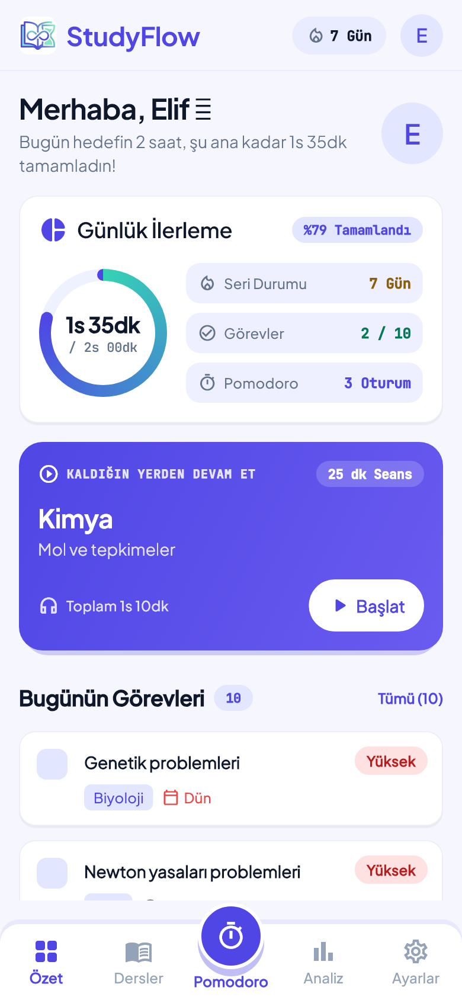
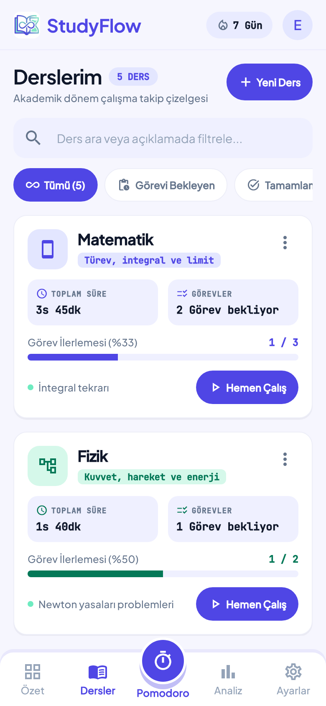
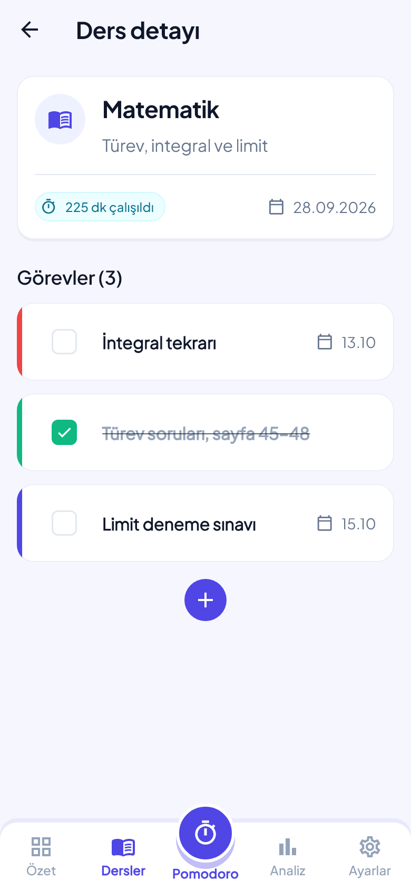
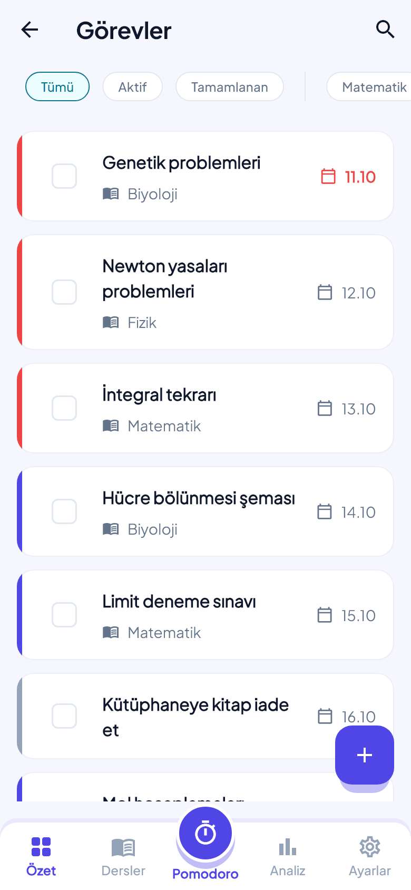
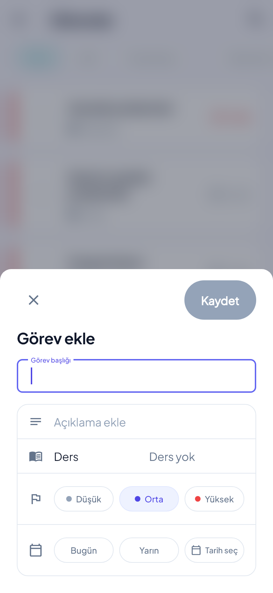
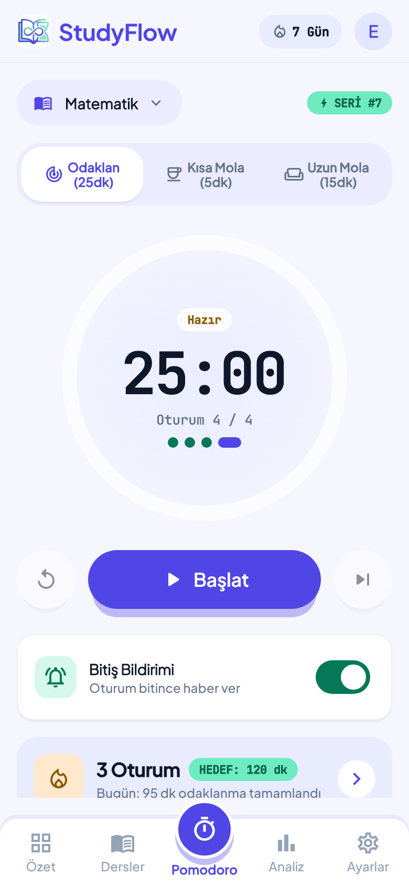
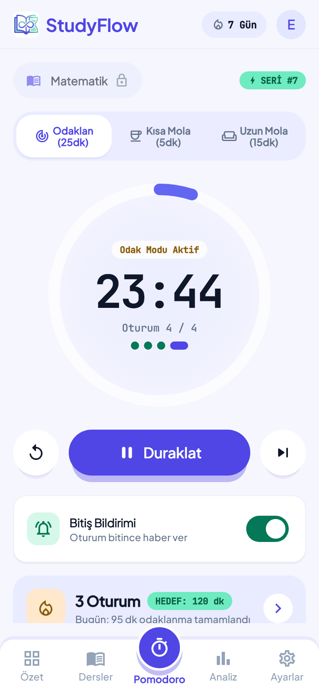
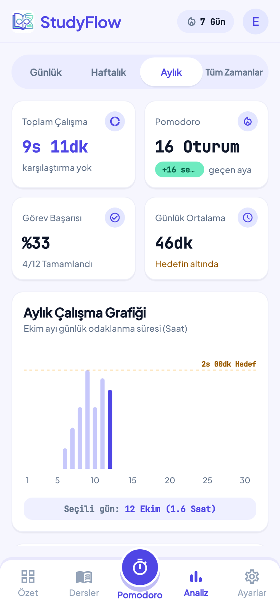
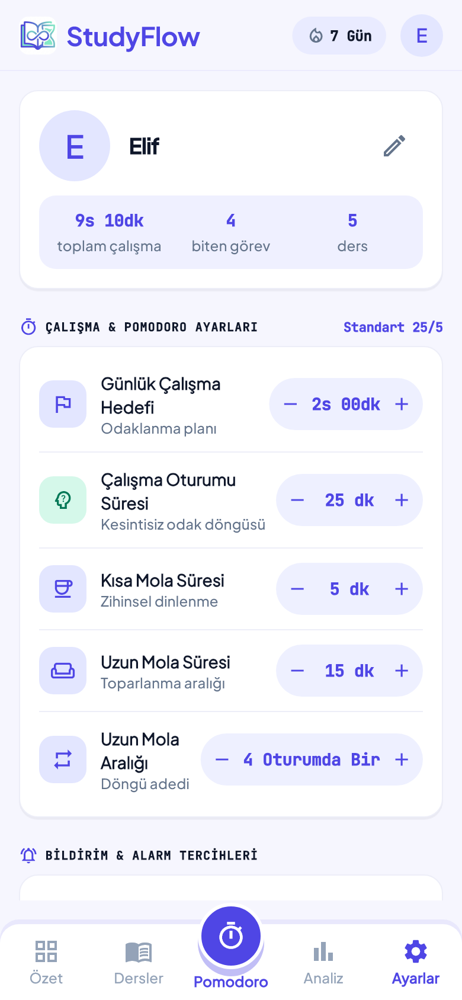

# StudyFlow

StudyFlow, öğrencilerin derslerini, görevlerini ve çalışma sürelerini tek yerden takip edebildiği bir Flutter mobil uygulamasıdır. Kullanıcı ders ve görev ekler, Pomodoro ile çalışma oturumu başlatır, günlük ve haftalık çalışma istatistiklerini inceler. Veriler cihazda saklanır, internet gerekmez.

## Proje amacı

- Derslerini ve görevlerini düzenli tutmak,
- Pomodoro tekniğiyle çalışma süresini ölçmek ve kaydetmek,
- Ne kadar, hangi derse çalışıldığını gerçek verilerden görmek.

## Özellikler

Durum tablosu, proje ilerledikçe güncellenir.

| Modül | Neler yapabilir | Durum |
|---|---|---|
| **Dersler** | Listeleme (eklenme sırasıyla), ekleme, düzenleme, silme (kart menüsü ya da uzun basma), arama ve filtre çipleri, ders detayı, derse bağlı görev ilerlemesi, toplam süre, "Hemen Çalış" kısayolu, "Genel Performans" kartı | Tamam |
| **Görevler** | Ekleme, düzenleme, silme, tamamlama, öncelik, son tarih, erteleme, arama ve filtreleme (durum, ders). Alt menüde değil; Özet'teki "Tümü" bağlantısıyla açılır | Tamam |
| **Pomodoro** | Başlat / duraklat / devam / sıfırla / bitir, Odaklan – Kısa Mola – Uzun Mola aşamaları (uzun mola her N oturumda bir kendiliğinden gelir), "Oturum 3 / 4" göstergesi, seri rozeti, derse bağlı ya da serbest çalışma, oturum kaydı, bildirim anahtarı, bugünkü oturum özeti | Tamam |
| **Analiz** | Günlük / Haftalık / Aylık / Tüm Zamanlar aralığı; toplam çalışma, Pomodoro sayısı, görev başarısı ve günlük ortalama kartları (önceki dönemle karşılaştırmalı); dokunulabilir sütun grafiği ve hedef çizgisi; derslere göre halka grafik ve süre çubukları; en verimli saat aralığı; gerçek verilerden hesaplanan rozetler | Tamam |
| **Ayarlar** | Profil kartı (isim, toplam çalışma, biten görev, ders sayısı), günlük hedef, çalışma / kısa mola / uzun mola süresi ve uzun mola aralığı, bildirim anahtarı, verileri JSON olarak panoya yedekleme, uygulama bilgisi | Tamam |
| **Özet (Dashboard)** | "Merhaba, isim", günlük ilerleme halkası (seri, görevler, Pomodoro), "Kaldığın yerden devam et" kartı, bugünün görevleri (buradan tamamlanır), son aktiviteler | Tamam |
| **Bildirimler** | Çalışma süresi bitince yerel bildirim: Pomodoro başlarken önceden planlanır, uygulama arkadayken ve ekran kilitliyken de gelir. İzin ilk Pomodoro'da istenir, Ayarlar'daki anahtarla kapatılır | Tamam |

## Kullanılan teknolojiler

| Alan | Paket |
|---|---|
| Çerçeve | Flutter, Dart (SDK `^3.13.1`) |
| Route ve bağımlılık yönetimi | `flutter_modular` |
| Yerel veritabanı | `hive`, `hive_flutter` |
| HTTP katmanı | `dio` |
| Grafik | `fl_chart` |
| Bildirim | `flutter_local_notifications` |
| Yazı tipi, tarih | `google_fonts` (Plus Jakarta Sans ve JetBrains Mono `google_fonts/` klasöründe gömülü, internet gerekmez; lisanslar SIL OFL 1.1), `intl` |
| Kimlik üretimi | `uuid` |
| Test | `flutter_test`, `mocktail`, `integration_test` |

## Proje mimarisi

Uygulama **MVVM** düzenindedir. Veri tek yönde akar:

```
View  →  ViewModel  →  Repository  →  Hive (yerel veritabanı)
```

- **View:** sadece çizer ve kullanıcı dokunuşunu ViewModel'e iletir. Hesap, veri okuma ya da kayıt yapmaz.
- **ViewModel:** `ChangeNotifier`. Ekranın durumunu (`loading`, `empty`, `error`, `success`) ve hazır sonuçlarını tutar, değişince ekrana haber verir. Yalnızca Repository'leri bilir; `BuildContext` ya da widget içermez.
- **Repository:** ViewModel ile veritabanı arasındaki tek kapıdır. Hive'a doğrudan o dokunur.
- **Hive kutuları** `main.dart`'ta değil modüllerde açılır: her modül sayfasını `HiveBoxesGate` ile sarar ve kendi kutularını listeler (`<modül>_module.dart`). Kutu zaten açıksa beklemez; açık kutular kapatılmaz, çünkü aynı kutuyu birkaç modül kullanır. `main.dart` yalnızca Hive'ın klasörünü hazırlar.
- **Saf hesaplar** (örneğin istatistik hesapları) ayrı bir sınıfta tutulur, ekrandan ve veritabanından bağımsız test edilir.

### Klasör yapısı

```
lib/
├── main.dart, app_widget.dart     Uygulama girişi
├── app_module.dart                Ana modül, alt modülleri bağlar
├── app_shell.dart                 Alt menü (ortada yuvarlak Pomodoro düğmesi) ve sayfa alanı; üst çubuk her ana sekmede `MainTopBar` ile gelir
├── core/                          Ortak parçalar
│   ├── constants/                 Sabitler (Hive kutu adları)
│   ├── network/                   Dio ayarı, hata sınıfı
│   ├── theme/                     Renk, boşluk, yazı stili, tema
│   ├── utils/                     Yardımcılar (süre yazısı, gün kısaltması...)
│   └── widgets/                   Ortak bileşenler (kart, buton, çip, durum görünümleri)
├── data/
│   ├── local/                     Hive kaynakları
│   ├── remote/                    Dio ile yazılmış yerel sahte API katmanı
│   └── repositories/              Repository'ler
├── models/                        Birden çok modülün kullandığı modeller
└── modules/
    └── <modül>/                   dashboard, subjects, tasks, pomodoro, statistics, settings
        ├── <modül>_module.dart    Modülün rotaları ve bağımlılık kayıtları
        ├── view_model/            ViewModel (ve varsa saf hesap sınıfları)
        ├── view/                  Sayfalar
        │   └── widgets/           Sayfaya özel bileşenler
        └── models/                Sadece bu modülün ekranlarında kullanılan modeller
```

Proje kökünde `lib/` dışında şunlar vardır: `test/` ve `integration_test/` (testler; entegrasyon testi Flutter kuralı gereği `test/` içine değil kökte durur), `tool/` (ikon ve ekran görüntüsü üreten araçlar), `google_fonts/` (gömülü yazı tipleri), `screenshots/` (README görüntüleri).

**Model nereye konur?** Tek modülün ekranlarına özel olan model o modülün `models/` klasörüne, `data/` katmanının ya da birden çok modülün kullandığı model `lib/models/` altına gider.

**Bağımlılık enjeksiyonu:** Her modül, kendi bağımlılıklarını kendi `*_module.dart` dosyasında `addLazySingleton` ile kaydeder; sayfalar ViewModel'i `inject<T>()` ile alır.

## Kurulum

Gereksinimler: Flutter SDK (Dart `^3.13.1` ile uyumlu sürüm) ve bir Android cihaz ya da emülatör.

```bash
git clone https://github.com/kubrainy/StudyFlow.git
cd StudyFlow
flutter pub get
flutter run
```

### Release APK

```bash
flutter build apk --release
```

APK `build/app/outputs/flutter-apk/app-release.apk` yoluna çıkar. Release imzası `android/key.properties` dosyasından ve `android/app/studyflow-release.jks` anahtarından okunur; ikisi de git'e girmez. Bu dosyalar yoksa (örneğin proje yeni klonlandıysa) Gradle debug anahtarıyla imzalar, yani proje yine derlenir ama bu APK mağazaya yüklenemez.

### Uygulama ikonu

Android ikonları `android/app/src/main/res/` altındadır, uygulama içindeki logo `assets/images/studyflow_logo.png` dosyasıdır.

## Testler

```bash
flutter analyze     # statik analiz
flutter test        # birim ve widget testleri
flutter test integration_test/app_flow_test.dart -d windows   # tam akış (~1 dk)
```

Testler `test/` altında, `lib/` ile aynı klasör düzenindedir. Repository'ler `mocktail` ile taklit edilir, ViewModel testleri gerçek veritabanına ihtiyaç duymaz.

- **Layout testi** (`test/layout/screen_sizes_test.dart`): sayfaları ve alt menüyü 7 ekran boyutunda ve 3 yazı ölçeğinde (normal, 1.3×, 1.6×) çizer; taşma ya da kesilen etiket varsa düşer.
- **Integration testi** (`integration_test/app_flow_test.dart`): gerçek Hive ile ders → görev → Pomodoro → oturum kaydı → istatistik akışını uçtan uca dener (~1 dk, masaüstü penceresi görünür olmalı).
- **İnternetsiz cihaz doğrulaması** (Android 15 telefon, hiçbir ağ bağlı değil): ders ekleme ve silme (bağlı görevlerle birlikte), görev ekleme ve tamamlama, derse bağlı Pomodoro oturumu kaydı, Pomodoro başlarken bitiş alarmının kurulması, duraklatınca iptal edilmesi, devam edince yeniden kurulması, bitirince iptal edilmesi ve İstatistikler ekranındaki rakamlar sorunsuz çalıştı.

## Ekran görüntüleri

Görüntüler örnek verilerle alındı; "Elif" ve dersler örnektir.

<table>
  <tr>
    <td align="center"><br>Ana sayfa</td>
    <td align="center"><br>Dersler</td>
    <td align="center"><br>Ders detayı</td>
  </tr>
  <tr>
    <td align="center"><br>Görevler</td>
    <td align="center"><br>Görev ekleme</td>
    <td align="center"><br>Pomodoro (hazır)</td>
  </tr>
  <tr>
    <td align="center"><br>Pomodoro (çalışıyor)</td>
    <td align="center"><br>İstatistikler</td>
    <td align="center"><br>Ayarlar</td>
  </tr>
</table>

Görüntüler `tool/screenshots/` araçlarıyla üretildi.
